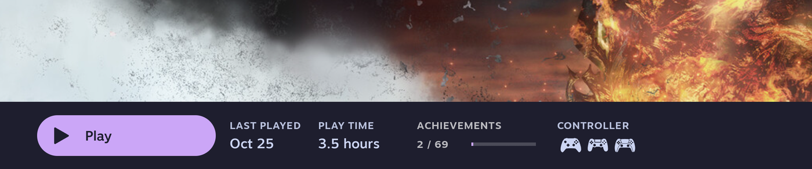

# Achievements Label (Decky plugin)

Brings an **Achievements** column back to the game details bar in Steam's Big Picture mode:



Unlocked / total, plus a progress bar. The column is hidden for games without achievements.

## How it works

Steam still keeps the numbers. The plugin reads them from Steam's own achievement cache and draws the column in the
Big Picture page. No network access, no accounts, no API keys, no settings.

## Install

1. Copy this folder to `~/homebrew/plugins/achievements-label` (it needs `dist/index.js`, `main.py`, `plugin.json`, `package.json`).
2. Restart Decky Loader (`sudo systemctl restart plugin_loader` on SteamOS, `sudo rc-service plugin_loader restart` on OpenRC) and open Big Picture.

## Extending it (other plugins)

For games Steam has no achievements for (non-Steam shortcuts, emulators...), another plugin can register a provider:

```js
const hub = (window.__achievementsLabel = window.__achievementsLabel || { providers: [] });
hub.providers.push(async (appid, name) => ({ unlocked: 3, total: 20 })); // or null if unknown
```

A provider gets the Steam app id and the game's display name and returns `{ unlocked, total }` or `null`. Providers are asked
in order and the first answer with `total > 0` wins. Whichever plugin loads first creates the hub, so load order doesn't matter.

## Known limits (please read)

- **Tested on one setup only:** a Linux desktop (Gentoo, OpenRC) with Steam in English. Not tested on a Steam Deck / SteamOS,
  other languages, or other Steam versions.
- **It uses Steam's private internals** (`appAchievementProgressCache`, `SteamUIStore`, `g_PopupManager`, and a hashed CSS class
  for the details bar). Steam updates can rename them, and then the column silently disappears instead of showing wrong numbers.
  If it does, `BAR_CLASS` at the top of `dist/index.js` is the first thing to check.
- If the hashed class no longer matches, the plugin falls back to finding the bar by the text "Last Played", which only works with
  an English Steam UI.
- The column is added with CSS (`::after` on the bar), so its look is approximate. The `CSS` block in `dist/index.js` has the sizes.
